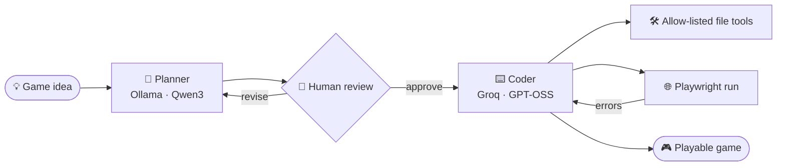
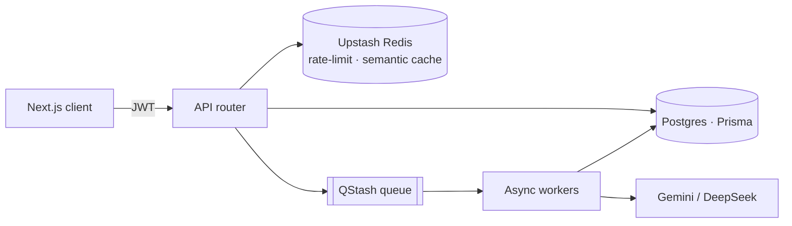
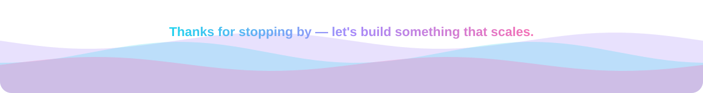

  
  
  
  
  

## ⚡ Featured builds

<table>
  <tr>
    <td width="50%"></td>
    <td width="50%"></td>
  </tr>
  <tr>
    <td width="50%"></td>
    <td width="50%"></td>
  </tr>
</table>

<b>🧭 How GamingAgent thinks</b> — plan → approve → code → run → repair

 

<b>🏗️ How CareerForge scales</b> — async workers, cache, RBAC

 

## 🧰 Toolbox

  <b>Languages</b>  
  

  <b>Frontend · Backend</b>  
  

  <b>Data · AI · Cloud</b>  
  

## 📈 Signal

  
  

  

  

<picture>
  <source media="(prefers-color-scheme: dark)" srcset="https://raw.githubusercontent.com/omgond7/omgond7/output/snake-dark.svg"/>
  <source media="(prefers-color-scheme: light)" srcset="https://raw.githubusercontent.com/omgond7/omgond7/output/snake.svg"/>
  
</picture>

## 🏅 Wins & certs

| | |
|---|---|
| 🏆 **Uplifters Award** — Sumago Infotech | 🥇 **Winner of the Week** × 2 |
| ☁️ **AWS Academy** — Cloud Foundations | 🏛️ **AWS Academy** — Cloud Architecting |

## 🗺️ Now leveling up

`Advanced DSA` · `System Design` · `Distributed Systems` · `Microservices` · `Cloud Infrastructure` · `Design Patterns` · `Agentic AI`

 

